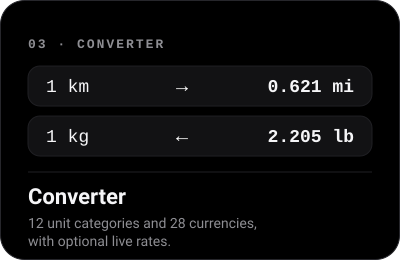

 

  

[Features](#features)  ·  [Install](#install)  ·  [Privacy](#privacy)  ·  [Website](https://eryx-app-tau.vercel.app/)

## About

**eryx** is a free Android calculator that stays out of your way. It works fully offline, shows no ads, needs no account and fits in about 2 MB. You get a scientific keyboard, graphing, unit and currency converters, and finance tools like GST and loan EMI, plus a home screen widget.

## Features

<table>
  <tr>
    <td></td>
    <td></td>
    <td></td>
  </tr>
  <tr>
    <td></td>
    <td></td>
    <td></td>
  </tr>
</table>

## Install

1. Download **[eryx-v1.0.6.apk](https://github.com/Shubham-Mohite7/eryx-calc/raw/refs/heads/main/eryx-v1.0.6.apk)** (2.0 MB, Android 8.0 or later).
2. Open the file and allow installs from this source when Android asks.
3. Launch **eryx**.

Browser shows a warning about the APK?

 

That is normal for apps installed outside the Play Store. Choose **Download anyway**, then open the file to install.

## Privacy

No ads, no tracking, no account. Your history stays on your phone, and currency rates work offline with live rates as an option. Read the full [privacy policy](https://eryx-app-tau.vercel.app/privacy).

## Feedback

Found a bug or have an idea? [Open an issue](https://github.com/Shubham-Mohite7/eryx-calc/issues). If you like eryx, a ⭐ on this repo helps a lot.

 

