 

  

  

**[Website](https://eryx-app-tau.vercel.app/)**  ·  **[Download](https://github.com/Shubham-Mohite7/eryx-calc/raw/refs/heads/main/eryx-v1.0.6.apk)**  ·  **[Privacy](https://eryx-app-tau.vercel.app/privacy)**

## What is eryx?

**eryx** is a free Android calculator that stays out of your way. It works fully offline, shows no ads, needs no account and fits in about 2 MB. Under the clean black interface you get a scientific keyboard, function graphing, unit and currency converters, and everyday finance tools like GST and loan EMI.

## Screens

  
  
  
  
  

Standard  ·  Scientific  ·  Graph  ·  Converter  ·  Financial

## Features

<table>
  <tr>
    <td></td>
    <td></td>
    <td></td>
  </tr>
  <tr>
    <td></td>
    <td></td>
    <td></td>
  </tr>
</table>

Also included: a home screen **widget**, full **offline** operation and **ad-free** use.

## Install

1. Download the latest APK: **[eryx-v1.0.6.apk](https://github.com/Shubham-Mohite7/eryx-calc/raw/refs/heads/main/eryx-v1.0.6.apk)** (2.0 MB).
2. If your browser warns about APK files, choose **Download anyway**.
3. Open the downloaded file and allow installs from this source when Android asks.
4. Launch **eryx** and start calculating.

**Requirements:** Android 8.0 or later.

## Privacy

eryx has no ads, no tracking and no account. Your calculation history stays on your phone. Currency rates work offline with 28 bundled currencies, and live rates are optional. Read the full [privacy policy](https://eryx-app-tau.vercel.app/privacy).

## Feedback

Found a bug or have an idea? [Open an issue](https://github.com/Shubham-Mohite7/eryx-calc/issues). If you like eryx, a ⭐ on this repo helps a lot.

 

